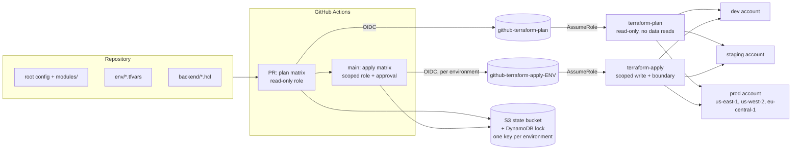

# terraform-multi-env-platform

One Terraform code base that deploys to many environments, across regions and
AWS accounts, with a CI pipeline whose plan and apply identities are separate and
least-privilege.

This is a compact, generic reference implementation of a pattern I introduced on
a production multi-region, multi-account platform. Account IDs (`111111111111`, `222222222222`, ...), the
organisation (`acme`) and the state bucket names are placeholders.

## The problem

The starting point was one copy of the Terraform per environment and region. Copies drift: a fix applied to production was forgotten in staging, a
module bump landed in three of five directories, and every change had to be made,
reviewed and tested N times. Nobody could say with confidence that two
environments differed only where intended.

## The design

One root configuration, parameterised. An environment is exactly two small files:
`env/<env>.tfvars` (what differs) and `backend/<env>.hcl` (where its state lives).
A change to the code ships to every environment through the same pipeline.



Layout:

```
.
├── main.tf versions.tf variables.tf locals.tf outputs.tf   root configuration
├── env/                 dev, staging, prod-us-east-1, prod-us-west-2, prod-eu-central-1 (.tfvars)
├── backend/             matching partial backend configs (.hcl)
├── modules/
│   ├── network/             VPC, subnets over N AZs, optional NAT, flow logs
│   ├── compute/             ECS Fargate service, separate task/execution roles
│   └── security-baseline/   KMS, S3 (SSE-KMS, TLS-only, public access block), IAM policies
├── bootstrap/           state backend + GitHub OIDC provider and CI roles (run once)
│   └── target-account/  terraform-plan / terraform-apply roles + workload permissions boundary (run once per account)
├── .github/workflows/terraform.yml
├── Makefile             the single entry point for humans and CI
└── .tflint.hcl
```

What each part shows:

- **Parameterisation.** `region` and `target_account_id` are variables. The AWS
  provider assumes `arn:aws:iam::<target_account_id>:role/<target_role_name>`, so
  one run targets one account and one region. dev and staging have their own
  accounts; the three prod environments share a prod account and differ by region.
- **Modules** with validated inputs (CIDR size, AZ count, retention values,
  bucket names), outputs, and READMEs. Small enough to read in a few minutes.
- **Tagging.** `Environment`, `Owner`, `CostCenter`, `Project`, `ManagedBy` are set
  once through provider `default_tags`, so every taggable resource gets them and
  cost allocation works without per-resource effort.
- **Security baseline.** Bucket policy denies requests where `aws:SecureTransport`
  is false, public access is blocked, objects are encrypted with a rotated
  customer-managed key, and the task role gets a read/write policy scoped to that
  bucket and key (no delete). Every IAM role the stack creates carries the
  `terraform-workload-boundary` permissions boundary.
- **Cost flags.** NAT is opt-in and can be shared (`single_nat_gateway`) or per-AZ.
  Dev and staging share one NAT, prod uses one per AZ.

## Adding an environment

1. Copy `env/prod-us-west-2.tfvars` to `env/<new>.tfvars`; set `environment`,
   `region`, `target_account_id`, and a non-overlapping `vpc_cidr`.
2. Copy `backend/prod-us-west-2.hcl` to `backend/<new>.hcl`; change only the `key`.
3. Add the environment to `bootstrap/variables.tf` (`environments`) and re-apply
   bootstrap to create its apply role. In the target account, run (or re-apply)
   `bootstrap/target-account` with that role in `apply_principal_names`.
4. Add the name to both matrices in `.github/workflows/terraform.yml` (and to
   `ENVS` in the `Makefile`, which lists environments in its help), and create a
   GitHub Environment of the same name with `APPLY_ROLE_ARN`, a deployment-branch
   rule for `main`, and reviewers.

No Terraform code changes. `make plan ENV=<new>` works immediately.

## Running it

```sh
make plan  ENV=prod-us-west-2                  # read-only role; non-zero exit only on error
make plan  ENV=dev ROLE=terraform-apply        # what CI does before an apply
make apply ENV=dev                             # applies exactly the saved plan, only if it has changes
make validate-all                              # init -backend=false + validate everywhere, no credentials
```

`make plan` runs `terraform init -reconfigure -backend-config=backend/$ENV.hcl`
followed by `plan -var-file=env/$ENV.tfvars -detailed-exitcode`, and records
terraform's code (0 no changes, 2 changes) in `.plans/$ENV.exitcode`. CI calls the
same targets, so a human reproduces a pipeline result by running the same command.

## CI flow and security model

Pull request: `fmt -check`, `init -backend=false` plus `validate` for the root and
every module, `tflint`, then a `plan` matrix over all environments. The plan for
each environment is posted to the PR and the step summary.
Merge to `main`: an `apply` matrix, one environment at a time in order
(`max-parallel: 1`, `fail-fast: true`), each gated by its GitHub Environment
(required reviewers on staging and prod, deployments from `main` only). After
approval each job re-plans with the apply role and applies that saved plan only if
it has changes. Reviewers therefore approve the merged commit, whose per-environment
plans they saw on the PR, not the byte-identical plan file; see "What I would add".

| | plan role | apply role |
|---|---|---|
| Who can assume (OIDC `sub`, `StringEquals`) | exactly `repo:<org>/<repo>:pull_request` | exactly `repo:<org>/<repo>:environment:<env>`, one role per environment |
| State access | read objects; lock items under the state prefix | read/write only that environment's key; only that environment's lock items (`dynamodb:LeadingKeys`) |
| In the target account | `terraform-plan`: AWS `ReadOnlyAccess` with data-plane reads (S3 objects, DynamoDB items, SSM parameters, secrets, log events) denied | `terraform-apply`: service-scoped write; IAM limited to `<org>-*` names, and roles can only be created or given permissions with the `terraform-workload-boundary` boundary; `PassRole` limited to named services |
| Can change infrastructure | no | yes, after approval, from `main` only |

There are no stored cloud credentials. The OIDC provider, both roles and their
trust policies are in `bootstrap/github_oidc.tf`; the per-account roles are in
`bootstrap/target-account/main.tf`. Pin third-party actions to commit SHAs in a real
deployment; tags are used here for readability.

Why the boundary matters: limiting IAM to `<org>-*` names is not enough on its own,
because a role allowed to create `<org>-admin` with `AdministratorAccess` attached
can then assume it. Requiring `iam:PermissionsBoundary` on every role it creates or
grants permissions to caps any such role at what the workloads need, and the
boundary policy is outside the `<org>-*` namespace the apply role may edit.

The plan role does have one write: `terraform plan` takes the state lock, so it can
put and delete items in the lock table. It cannot write state objects.

**Known risk: pull-request plans run untrusted code.** `terraform plan` executes
provider and data-source code, so anyone who can open a pull request from a branch
of this repository can change the Terraform or the workflow and run arbitrary code
with the plan role. It is accepted for the review value of a plan on every PR, and
contained: the role is read-only; data-plane reads are denied in target accounts;
pull requests from forks get no OIDC token (keep "Send write tokens to workflows
from pull requests" off and require approval for outside contributors); lock writes
are limited to this stack's keys. Keep repository write access small and protect
`.github/` and `bootstrap/` with CODEOWNERS and branch protection. On a public repo,
remember that plan output posted to PRs is public too.

### Design note: do not let a failed plan pass

A classic pipeline bug is a green check on a broken plan. `terraform plan`
returns 1 on error, 0 for no changes and 2 for changes (with
`-detailed-exitcode`). Pipelines go wrong two ways: treating every non-zero code as
failure (so any pending change breaks the build), or hiding the code with
`terraform plan | tee`, `|| true`, or the `setup-terraform` wrapper, so an error
looks like success. A third, subtler one: wrapping terraform in `make`. GNU make
exits 2 for *any* failed recipe, so `make plan` returning 2 cannot tell "changes"
from "error", and a pipeline that trusts it turns every failed plan green.

Here the workflow sets `terraform_wrapper: false`; the `plan` target captures
terraform's code itself, writes 0 or 2 to `.plans/<env>.exitcode`, and fails on
anything else; the workflow checks make's status first and reads the code from the
file, never from make. The comment step runs with `if: always()` so an errored plan
is still visible. The same file gates apply: only a recorded 2 triggers
`make apply`, which itself refuses to run without a successful plan with changes.

## State layout

One S3 bucket and one DynamoDB lock table in a tooling account, one state object
per environment: `platform/<env>/terraform.tfstate`. The bucket is versioned,
encrypted (SSE-S3), private, and TLS-only; the lock table is pay-per-request with
point-in-time recovery. The `bootstrap/` stack creates them and uses local state
because it must exist before the backend does.

Locking: DynamoDB, because it works with Terraform 1.6+ (the minimum here).
Terraform 1.10 added S3-native locking (`use_lockfile = true`), and later releases
deprecate the DynamoDB arguments. If you can require a version with S3-native
locking, prefer it; the change is one backend argument and a smaller plan-role
policy (the plan role would then need `s3:PutObject` and `s3:DeleteObject` on the
`.tflock` objects instead).

## Tradeoffs considered

- **Workspaces.** One backend, `terraform.workspace` selects state. Cheap, but all
  environments share one bucket, credentials and blast radius, the active workspace
  is invisible in the working tree (people apply to the wrong one), and per-account
  or per-region credentials are awkward. Rejected for environments that sit in
  different accounts. Fine for short-lived copies of one environment.
- **tfvars plus backend files (chosen).** Explicit, greppable, trivially reviewed:
  a diff to `env/prod-us-west-2.tfvars` is exactly what changes there. The cost is a
  little repetition across tfvars and a Makefile to keep the pairing honest.
- **Terragrunt.** Removes the tfvars/backend repetition and handles dependencies
  between stacks well. It adds a tool, a second configuration language and a
  learning curve. Worth it when there are many stacks per environment; for one root
  and five environments it was not.
- **Copy per environment.** What this replaces; drift is the failure mode.
- **When to split state.** One state per environment is the minimum. Split further
  (network, data, workloads) when plans get slow, when teams need independent
  release cadences, or when a destructive mistake in one layer must not be able to
  touch another. Here the three components share a state to keep the sample small;
  the module boundaries are where the cut would go, joined through outputs or
  `terraform_remote_state`/data sources.
- **Same code, different config.** Differences between environments must be
  expressible as variables. If an environment needs a resource that others lack,
  prefer a boolean or count-controlled module input over forking the code.

## What I would add at larger scale

- **Policy as code.** Run Conftest/OPA or Checkov against `terraform show -json`
  plans in CI to enforce things like encryption, tag presence and no public buckets
  before approval.
- **Drift detection.** A scheduled workflow running the plan matrix with the
  read-only role (adding the `ref:refs/heads/main` subject to its trust), alerting
  on changes or errors when nothing was merged.
- **Cost estimation.** Infracost on the PR plan, with a threshold that requires an
  extra reviewer.
- **Stronger apply scoping.** Resource-level ARNs and tag conditions in place of the
  service wildcards (`ec2:*`, `kms:*`, `s3:*`), and SCPs in the organisation as a
  backstop.
- **SSE-KMS on state, plan artifacts** passed from the PR to apply so the exact
  reviewed plan is applied, and module versioning via a registry once modules are
  shared across repositories.

## Verification

`terraform fmt -check -recursive` and `terraform validate` (with
`init -backend=false`) pass for the root, each module, `bootstrap/` and
`bootstrap/target-account/` (`make validate-all`). The plan/apply exit-code
handling was exercised with a stub `terraform` returning 0, 1 and 2. Nothing here
has been planned or applied against a real AWS account.

## License

MIT, see `LICENSE`.
